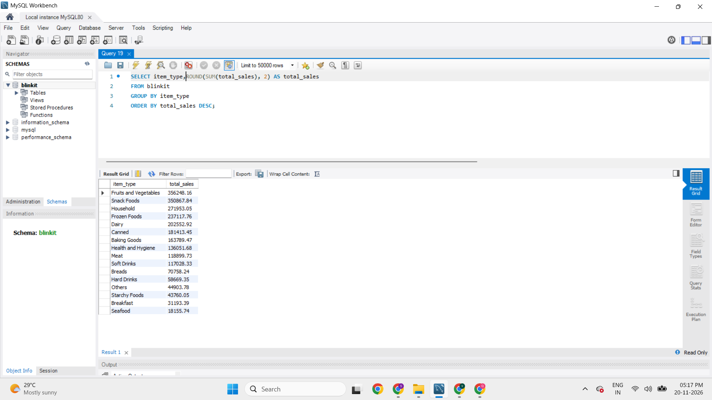
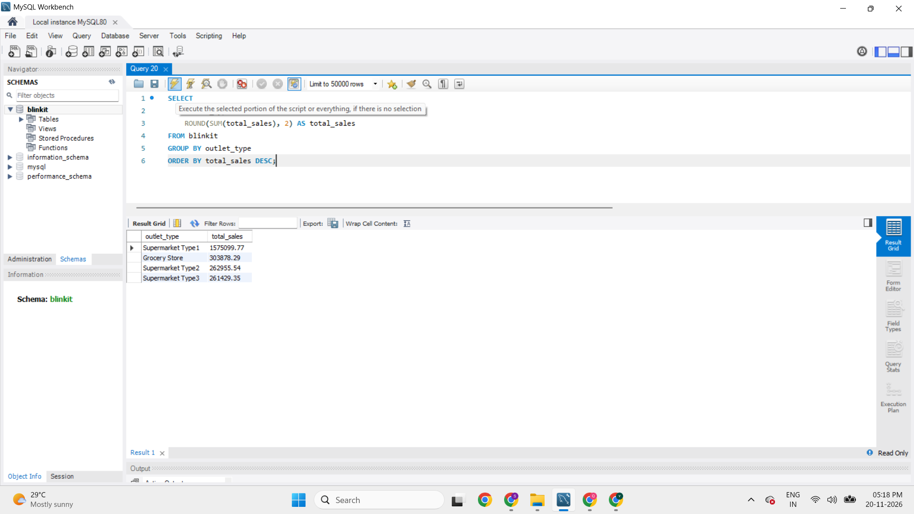
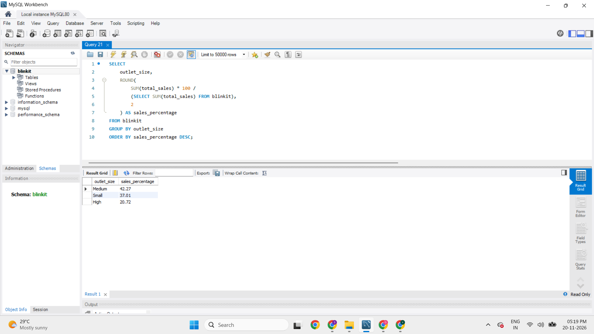
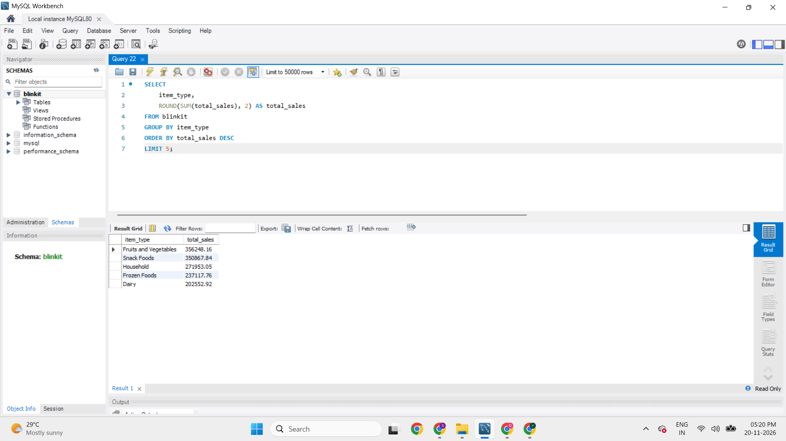
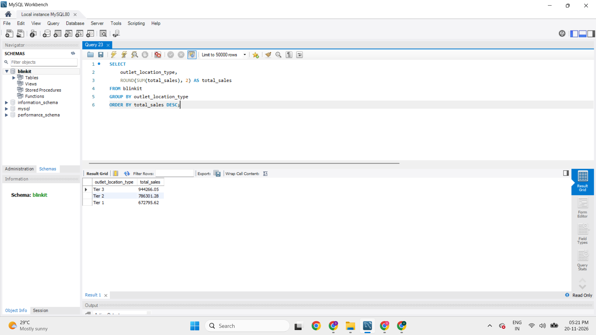
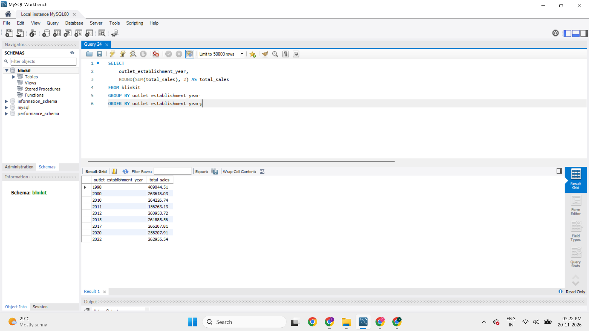

# BlinkIT Grocery Sales Analysis

## Project Overview
This project analyzes BlinkIT grocery sales data using SQL and MySQL Workbench to understand sales performance, product categories, outlet characteristics, and customer ratings.

## Objectives
- Analyze sales by fat content and item type.
- Compare sales performance across outlet types.
- Understand the impact of outlet size and location tier on sales.
- Evaluate outlet ratings.
- Explore outlet establishment year and sales performance.

## Analysis Performed
- Total Sales by Fat Content
- Total Sales by Item Type
- Total Sales by Outlet Type
- Sales by Outlet Establishment Year
- Sales by Outlet Location Tier
- Percentage of Sales by Outlet Size
- Average Rating by Outlet Type
- Number of Outlets by Tier
- Top 5 Item Types by Sales

## Tools Used
- MySQL
- MySQL Workbench
- SQL

## Project Files
- `blinkit_grocery.sql` — SQL queries used for analysis
- `BlinkIT_SQL_Project_Analysis.pptx` — Project presentation
  
## Key Findings

- Fruits and Vegetables generated the highest sales among item categories.
- Grocery Stores recorded the highest average rating.
- Sales performance varied across outlet types and location tiers.
- Outlet size contributed differently to overall sales distribution.
- Outlet establishment year was explored to understand sales patterns.

## SQL Analysis Results

### Sales by Item Type

### Sales by Outlet Type

### Sales by Outlet Size

### Top 5 Item Types

### Sales by Location Tier

### Sales by Establishment Year

## Conclusion

This project used SQL to analyze BlinkIT grocery sales data and identify patterns across product categories, outlet characteristics, sales distribution, and customer ratings.
